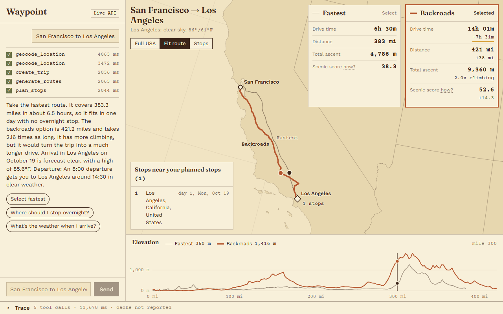
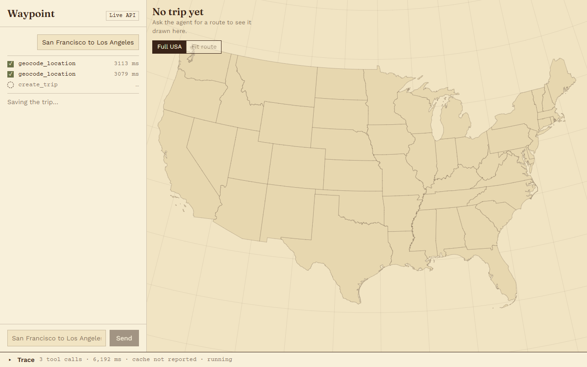
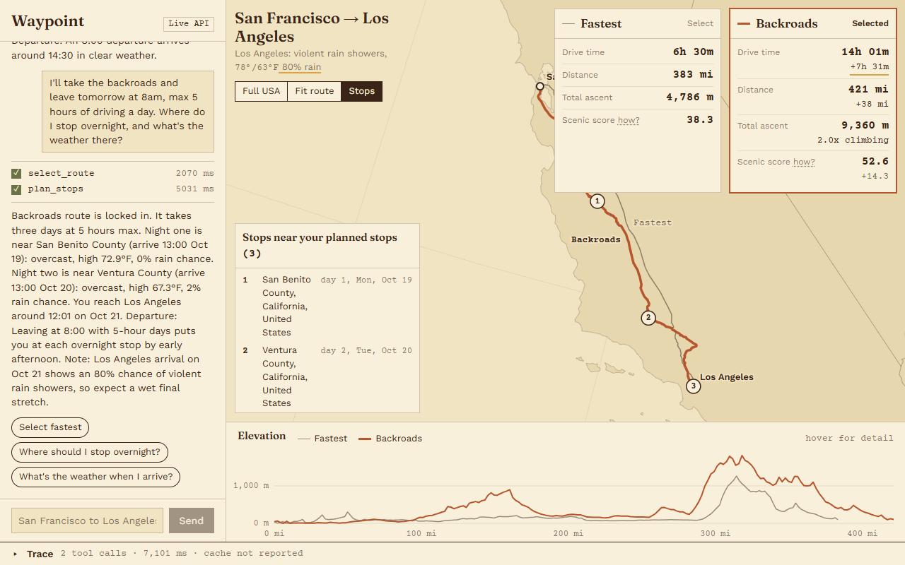
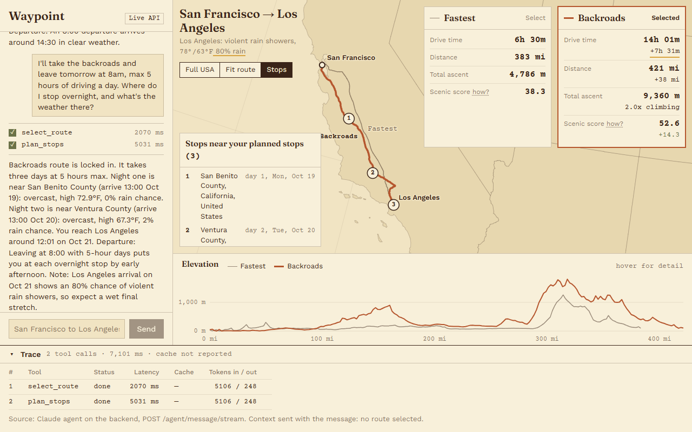
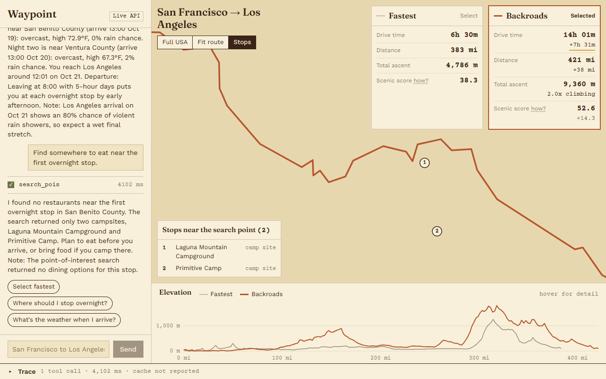
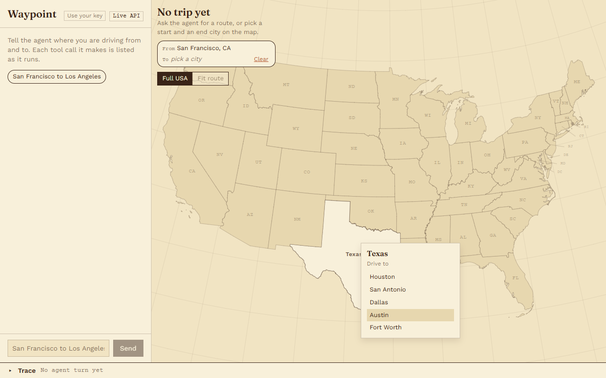
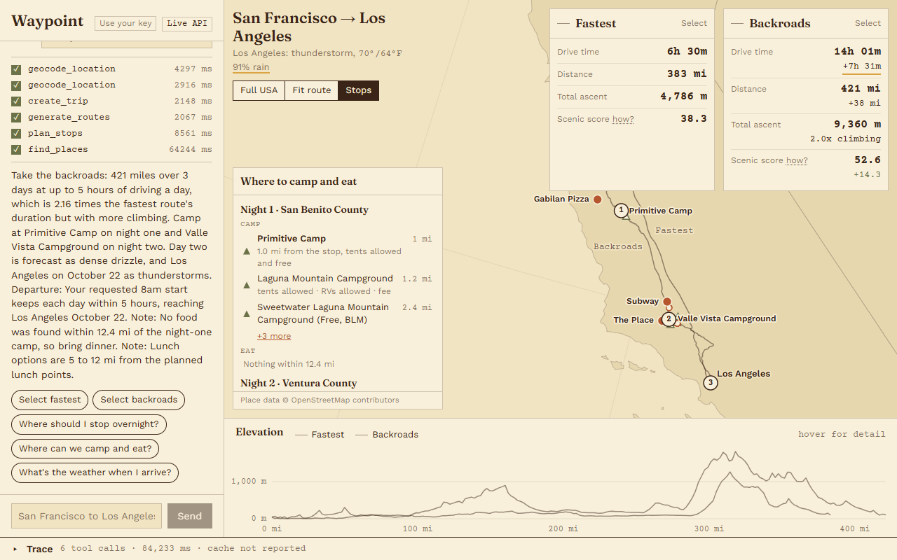
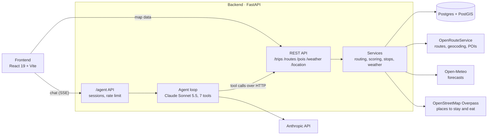

# Waypoint

[](https://github.com/alanshilu/waypoint/actions/workflows/ci.yml)

AI road-trip planner: a Claude tool-calling agent plans routes, overnight stops and weather on a FastAPI + PostGIS backend. React frontend. Agent evals: 1/10 → 10/10 cases.

Ask for a drive ("San Francisco to Los Angeles, I'll take the scenic route and leave tomorrow at 8am") and the agent geocodes both ends, generates a fastest and a scenic route, splits the drive into days, checks the weather at each stop **on the day you'll be there**, and finds places to stop. Every number it tells you comes from a tool result, and the app shows each tool call as it runs.



## Contents

- [Features](#features)
- [Screenshots](#screenshots)
- [How it works](#how-it-works)
- [Evals](#evals)
- [Tests and checks](#tests-and-checks)
- [Getting started](#getting-started)
- [API](#api)
- [Project structure](#project-structure)
- [Known limitations](#known-limitations)
- [Roadmap](#roadmap)
- [License](#license)

## Features

- **Two routes per trip.** A fastest route and a scenic route (avoiding highways; its id in the API is `backroads`), compared on drive time, distance, total climb and a terrain-based scenic score.
- **Overnight stops.** A deterministic planner splits long drives into days, honouring a daily driving limit and a departure time.
- **Weather on arrival dates.** Forecasts are fetched for each stop on the date you reach it, in that place's time zone.
- **Points of interest.** Food, fuel, lodging and sights near the destination or along the selected route.
- **Grounded answers.** The agent may only state numbers, dates and places that appear in its tool results, and it reports a failed tool rather than filling the gap.
- **Visible reasoning.** Each tool call streams to the chat as it runs (server-sent events), and a trace drawer shows latency, cache hits and errors per call.
- **Where to stay and eat.** For each night, the agent recommends a place to stay (a campground, RV park, motel, hotel, guest house, hostel, cabin or rental, following what you ask for) and a place to eat; for each day, a lunch stop where the drive reaches noon. Picks come with a reason from OpenStreetMap facts (showers, tents allowed, brand, stars, wifi, cuisine, hours), and every option found appears on the map and in a list.
- **Pick on the map.** States are labelled. Before a trip exists, you can choose a start and an end city from each state's five most populous cities (Census 2023 estimates) instead of typing.
- **Share and export.** "Share" copies a link (`/t/<public_id>`, a random UUID, never the trip's number) that opens the trip read-only: both routes, the picked one, the planned stops and the places, with no agent and no cost. "Google Maps" opens directions through the overnight stops, and "GPX" downloads the selected route as a track.
- **Mobile.** Under 768 px the app has Chat and Map tabs, one view at a time. It moves to the map when a trip or result arrives (unless you're typing), with "Back to chat" to return. Route cards, the elevation chart and folding lists sit under the map, and there's one menu for your key and the developer view. From 768 to 899 px the panels stack in one column. Controls are at least 44 px, checked with Playwright at 390x844 and 768x1024 (`node scripts/check-layout.mjs`, screenshots in [docs/screenshots](docs/screenshots/mobile-phone-04-trip-map.png)).
- **Mock mode.** The frontend runs entirely from fixtures, with no backend or API keys, for demos and UI work.
- **Ready for a public demo.** One `docker compose up` starts everything. Cost limits cap agent use per visitor and per day, and a demo mode makes all trip and route writes agent-only.
- **Bring your own key.** Heavy users can plug in their own Anthropic API key. Their turns are billed to them and skip the daily limit, and Waypoint never stores the key.

## Screenshots

One live conversation, captured on 2026-10-18: the real agent (Claude Sonnet 5.5) on the real backend, with routes from OpenRouteService and forecasts from Open-Meteo. The "Live API" badge marks live mode; mock mode shows "Mock data".

**1. The agent at work.** Each tool call appears as it starts and gets a tick and its latency when it finishes.


**2. Routes compared.** "San Francisco to Los Angeles": the fastest route is 383 mi in 6h 30m; the scenic route adds 7h 31m and twice the climbing, for a scenic score of 52.6 against 38.3. Hovering the elevation profile moves a marker along both routes on the map.


**3. Overnight stops with arrival-day weather.** "I'll take the backroads and leave tomorrow at 8am, max 5 hours of driving a day." The agent selects the scenic route and splits it into three days. Each night's forecast is for the date you get there, and it warns about an 80% chance of rain on arrival in Los Angeles.


**4. Tool trace.** The calls behind the last reply, with status, latency and the model tokens for each.


**5. Honest when the data is thin.** "Find somewhere to eat near the first overnight stop." The point-of-interest search found only two campsites, and the agent says so instead of naming a restaurant from memory.


**6. Pick a trip on the map.** Before a trip exists, hovering a state previews its five largest cities, and clicking or tapping it pins the list. Choosing a start and then a destination sends "Plan a trip from San Francisco, CA to Austin, TX" to the agent. It works from the keyboard too: Tab to a state, then Enter.


**7. Where to camp and eat.** "San Francisco to Los Angeles on the backroads, leave tomorrow at 8am, max 5 hours of driving a day. Where can we camp and eat?" The agent plans three days and picks:
- a campsite for each night, e.g. Primitive Camp, 1.0 mi from the night 1 stop, tents allowed and free
- dinner and lunch stops, widening the food search to about 12 miles where the scenic route runs far from any town

Where nothing turned up, it says to bring dinner instead of inventing a restaurant. Tents are campsites, circles are food, and the agent's picks are filled and named.


## How it works



The agent's tools call the backend's own REST API over HTTP, so the agent and the frontend share one code path for trips, routes, POIs and weather.

### The agent

[`Backend/app/agent/orchestrator.py`](Backend/app/agent/orchestrator.py) runs a tool-use loop on the Anthropic Messages API:

- **Model is configuration.** `AGENT_MODEL` (default `claude-sonnet-5-5`) and `AGENT_EFFORT` come from settings; nothing is hardcoded.
- **Structured final answer.** The last response is JSON matching a schema: `summary`, `recommended_route_type`, `departure_window`, `stops` (ids from `plan_stops`) and `warnings`. The chat shows the summary, departure reason and warnings; the stop ids tie each recommendation to a planned stop, which the evals check.
- **Small context.** Route geometry and elevation samples are replaced by short summaries before the model sees them (the trace keeps the full result), and the system prompt and tool definitions are prompt-cached.
- **Per-turn cache.** An identical tool call in the same turn runs once.
- **Guard rails.** At most 20 model calls per turn; refusals and cut-off answers become a clean reply with a warning.

| Tool | What it does |
|---|---|
| `geocode_location` | Place name to coordinates and a canonical label |
| `create_trip` | Saves a trip; reuses one with the same endpoints from the last 24 hours |
| `generate_routes` | Fastest and scenic (`backroads`) routes with distance, duration, climb and scenic score; reuses existing routes |
| `plan_stops` | Splits a route into driving days and returns overnight stops with arrival-date forecasts |
| `get_weather_forecast` | Forecast for a point on a target date |
| `search_pois` | Points of interest near a point |
| `find_places` | Places to stay (campgrounds to hotels) and to eat near every overnight and lunch stop in one call, ranked, with facts from OpenStreetMap |
| `select_route` | Locks in the route the user chose |

The system prompt is in [`Backend/app/agent/prompt.py`](Backend/app/agent/prompt.py). Its grounding rules: every number, date and place name must appear in a tool result (rounding, unit conversion, and differences or ratios of two tool numbers are allowed); coordinates passed to tools must come from other tool results; scores are never put on a scale ("/100", "out of 10").

### Scenic score

The scenic score measures terrain only: metres of climbing and descending per mile, mapped to 0-100.

```
density = (ascent_m + descent_m) / distance_miles
score   = 100 × density / (density + 40)
```

40 m/mi scores 50. Flat interstate lands around 20, SF to LA on I-5 around 38, the coastal scenic route around 53, sustained mountain driving 70+. It is a relative value for comparing routes, not a rating. How much slower a route is gets reported separately as `duration_vs_fastest`. Details: [`scoring_service.py`](Backend/app/services/scoring_service.py).

### Overnight stops

[`stop_planning.py`](Backend/app/services/stop_planning.py) walks the route geometry by cumulative driving time and ends each day where the daily limit runs out. It calls no external service or model, so the same inputs always give the same stops. Each stop is reverse-geocoded for a name and gets the forecast for its arrival date.

## Evals

Ten scripted conversations run against the real agent and a live local backend, graded by seven checks: six deterministic, one with a Claude Haiku 5.5 judge. Full method, cases and blind spots: [`Backend/evals/README.md`](Backend/evals/README.md).

Results on 2026-10-16, agent on Claude Sonnet 5.5, before and after the grounding work:

| Check | Baseline | Final |
|---|---|---|
| a. Every number grounded in a tool result | 8/10 | 10/10 |
| b. No invented scale ("/100") | 10/10 | 10/10 |
| c. Stops are real places from tool results | 6/10 | 10/10 |
| d. Weather fetched for arrival dates | 6/10 | 10/10 |
| e. POI searches at grounded coordinates | 10/10 | 10/10 |
| f. No duplicate trips or repeated calls | 10/10 | 10/10 |
| g. Concise reply (under 150 words, no emoji or tables) | 1/10 | 10/10 |
| **Cases passing every check** | **1/10** | **10/10** |
| Estimated cost of the whole run | $1.12 | $0.27 |

What changed between the two: a terrain-only scenic score, the deterministic `plan_stops` tool, a grounding prompt with a structured final answer, a per-turn tool cache, and idempotent trip and route creation. Cost fell about 76% because route geometry is no longer re-sent to the model on every loop iteration and the stable prefix is cached.

Read these numbers with two caveats: the final run is a single sample, and most final cases reused trips created by earlier runs, so fresh route generation was barely exercised.

```
cd Backend
python -m uvicorn app.main:app --port 8001
python -m evals.run --api-base http://localhost:8001
```

A full run costs well under $1 at the time of writing and stops itself at `--max-cost` (default $7).

## Tests and checks

[GitHub Actions](.github/workflows/ci.yml) runs these on every push. Results on 2026-10-19:

| Check | Command | Result |
|---|---|---|
| Backend unit and API tests | `pytest` | 151 passed in 13.5 s |
| Python lint | `ruff check .` | All checks passed |
| Frontend types | `npm run typecheck` | 0 errors |
| Frontend production build | `npm run build` | Builds |

The tests cover the following, with the model stubbed out:

- the agent HTTP API: sessions, rate limits, timeouts, streaming and error shapes
- the demo's cost limits, its endpoint locks and bring-your-own-key handling
- `/health` and `/ready`
- every eval check, on synthetic sessions
- the scenic score, stop planning and trip matching
- arrival-date weather across time zones
- route generation when OpenRouteService is slow or failing

They make no network or database calls. The app reads its settings at import time, from `Backend/.env` or the environment; CI sets dummy values.

## Getting started

You need an [OpenRouteService](https://openrouteservice.org/dev/#/signup) API key (free tier) and an [Anthropic](https://console.anthropic.com/) API key. The frontend's mock mode needs neither.

### Quick start with Docker

```bash
cp .env.example .env               # then add ORS_API_KEY and ANTHROPIC_API_KEY
docker compose up --build
```

Open http://localhost:8080. Compose starts three containers:

- **db:** PostGIS
- **backend:** applies the database migrations, then serves the API
- **frontend:** nginx, which serves the app and proxies `/api` to the backend

Only port 8080 is published. The settings for this setup are in the root [`.env.example`](.env.example).

### Prerequisites for running locally

- Python 3.13
- Node.js 22
- PostgreSQL with the PostGIS extension

### Backend

```bash
cd Backend
python -m venv .venv
source .venv/bin/activate          # Windows: .venv\Scripts\activate
pip install -r requirements.lock   # exact versions; requirements.txt has the ranges
cp .env.example .env               # then fill in the database and API keys
python -m alembic upgrade head     # creates the tables in your PostGIS database
python -m uvicorn app.main:app --port 8000
```

Every setting is listed with a comment in [`Backend/.env.example`](Backend/.env.example). Interactive API docs are at http://localhost:8000/docs.

### Frontend

```bash
cd Frontend
npm install
npm run dev                        # mock mode: fixtures, no backend needed
```

For the live agent, start the backend first, then:

```bash
VITE_USE_MOCK=false npm run dev                     # bash
$env:VITE_USE_MOCK = "false"; npm run dev           # PowerShell
```

Open http://localhost:5173. The backend allows CORS from that origin by default (`CORS_ORIGINS`). More detail: [`Frontend/README.md`](Frontend/README.md).

### Running the checks

```bash
cd Backend && pip install -r requirements-dev.txt && ruff check . && pytest
cd Frontend && npm run typecheck && npm run build
```

### Deploying as a public demo

Set these in the root `.env` before `docker compose up --build`:

```bash
PUBLIC_DEMO=true
INTERNAL_API_TOKEN=<a long random string>
POSTGRES_PASSWORD=<a strong password>
```

With `PUBLIC_DEMO=true`:

- `GET /trips/trips` is turned off.
- Creating trips and generating or selecting routes only works for callers sending the shared secret, which in practice means only the agent.
- The frontend is built so that a route picked on the map stays in the browser and goes to the agent with the next message.
- The backend won't start without `INTERNAL_API_TOKEN`.

The cost limits are on in every mode. They're set in `Backend/.env.example`, and 0 turns a limit off:

| Setting | Default | When reached |
|---|---|---|
| `AGENT_SESSIONS_PER_IP_PER_HOUR` | 5 | 429 `too_many_sessions` |
| `AGENT_DAILY_TURN_CAP` | 200 agent turns per UTC day, across all users | 429 "Demo limit reached, try again tomorrow" |
| `AGENT_MAX_SESSIONS` | 200 live sessions | 503 `demo_busy` |
| `AGENT_SESSION_TTL_S` | 1800 s idle | the session expires |

### Bring your own Anthropic key

Users who hit the daily limit, or plan a lot, can click **Use your key** in the chat panel and paste their own key. Their turns then run on that key: they're billed to the user's Anthropic account and don't count toward `AGENT_DAILY_TURN_CAP`. The other limits still apply.

How the key is handled, by design, with no accounts and no key storage:

- **In the browser:** it's kept in `sessionStorage`, so it's gone when the tab closes. It's sent only in the `X-Anthropic-Key` header of agent messages, never with other requests.
- **On the server:** [`own_key()`](Backend/app/api/v1/endpoints/agent.py) checks its shape before anything runs. The orchestrator builds an Anthropic client for that one turn and closes it when the turn ends. The key is never written to the session, the database or the logs, and never echoed back. Errors caused by the key say so ("Anthropic rejected your API key") without repeating it.
- **Tested:** [`tests/test_own_key.py`](Backend/tests/test_own_key.py) runs the real Anthropic SDK against a fake API that rejects the key. It checks that the key reached the API, then that it appears nowhere in the response, the stream, the stored session or the debug-level logs.

Serve the app over HTTPS so the key is encrypted in transit.

## API

| Method | Path | Purpose |
|---|---|---|
| GET | `/health` | Liveness: 200 while the process is up; never touches the database |
| GET | `/ready` | Readiness: 200 when the database answers `SELECT 1`, else 503 |
| POST | `/agent/sessions` | Start a conversation |
| POST | `/agent/message` | One agent turn, JSON response |
| POST | `/agent/message/stream` | The same turn as server-sent events: `tool_start`, `tool_end`, then `final` |
| GET | `/location/search` | Geocode a place name |
| POST | `/trips/` | Create a trip (`reuse_recent=true` returns a matching one from the last 24 h) |
| GET | `/trips/trips` | List trips |
| GET | `/trips/{trip_id}` | A trip with its routes and its `public_id` |
| GET | `/shared/{public_id}` | A shared trip, read-only: routes, the selected one, planned stops and places, with no trip, route or session ids. Rate limited per address (`SHARED_RATE_LIMIT_PER_MINUTE`, 30) |
| POST | `/trips/{trip_id}/plan` | Overnight stops for a route |
| POST | `/routes/generate/{trip_id}` | Fastest and scenic (`backroads`) routes |
| POST | `/routes/select/{route_id}` | Select a route |
| GET | `/pois/`, `/pois/search` | Points of interest |
| POST | `/places/search` | Places to stay and to eat near up to 10 points |
| GET | `/weather/current`, `/weather/forecast` | Current weather and forecasts |

Agent endpoints return errors as `{"error": {"code", "message"}}`, with `Retry-After` on 429 and 503. The message endpoints accept an optional `X-Anthropic-Key` header to run the turn on the caller's own key. With `PUBLIC_DEMO=true`, `GET /trips/trips` returns 404. `POST /trips/`, `/routes/generate/{trip_id}` and `/routes/select/{route_id}` return 403 without the `X-Waypoint-Internal` header.

## Project structure

```
Backend/
  app/
    agent/        orchestrator (tool loop), system prompt, sessions, the 7 tools
    api/v1/       FastAPI endpoints and serializers
    core/         settings and database engine
    models/       SQLAlchemy + GeoAlchemy models: trip, route, POI
    schemas/      Pydantic request and response models
    services/     routing, geocoding, POIs, weather, scoring, stop planning
  alembic/        database migrations (8)
  evals/          eval cases, checks, runner and the baseline/final reports
  tests/          pytest suite
  Dockerfile      backend image: migrates, then serves; non-root, health check
  requirements.lock, requirements-dev.txt   pinned dependencies
Frontend/
  src/
    components/   map, route comparison, elevation profile, chat, trace drawer
    state/        trip state and the chat/agent flow
    fixtures/     mock trip and POIs
  Dockerfile, nginx.conf   production build served by nginx, /api proxied to the backend
.github/workflows/ci.yml   lint, tests, typecheck and build on every push
docker-compose.yml         PostGIS, backend and frontend
docs/screenshots/          the images in this README
```

## Known limitations

- **OpenRouteService speed.** Route generation depends on ORS, which can be slow: on 2026-10-18 a single SF to LA request took between 10 s and over 100 s. Both routes are requested in parallel and each attempt may take up to `ORS_ROUTE_TIMEOUT_S` (90 s). Every ORS call (geocoding, directions, POIs) retries a timeout, HTTP 429 or 5xx up to 3 attempts in all, with exponential backoff and jitter, and waits as long as a `Retry-After` header asks (up to 30 s). A bad key or a bad request (any other 4xx) is not retried. All of a route's attempts stay inside `ORS_ROUTE_RETRY_BUDGET_S` (300 s by default, never more than half of `AGENT_TIMEOUT_S`, so the model and other tools keep the rest of the turn) and inside the agent turn's deadline, which the agent's tools pass to the backend. When ORS still fails, the endpoint returns 504 (timeout) or 502, and the step shows as failed in the chat checklist and the trace, with the reason.
- **Sessions and cost limits are in memory.** Sessions and the counters behind the cost limits are lost on restart, which also resets the day's turn count. With several worker processes, each one keeps its own. Run one backend process for now.
- **Bring your own key covers the model only.** A user's Anthropic key pays for their agent turns, but routes, geocoding and points of interest still use the server's OpenRouteService key and quota.
- **`PUBLIC_DEMO` covers trips and routes only.** `/location/search`, `/pois/search`, `/weather/*` and `POST /trips/{id}/plan` stay public. They write nothing, but each call spends OpenRouteService or Open-Meteo quota.
- **The per-IP limit trusts the proxy.** The visitor's address comes from the `X-Forwarded-For` header set by the nginx container. Don't publish the backend's port directly, or a client could set that header itself.
- **Stop planning assumes a uniform pace** along the route and uses the origin's time zone for the whole trip.
- **The evals are one sample** and have documented blind spots (place names are found by heuristic; any tool number can ground an equal number in the reply).
- **Searches for places to stay and eat depend on the free public Overpass service**, which swings between answering in seconds and taking minutes.
  - A search waits for it with no deadline of its own (each Overpass query ends on the server within 180 s); a second server is asked as soon as the first fails or is slow, and the chat shows how long the search has been running.
  - Results are cached for a day in the database (`places_cache`), so restarts and Render sleeps keep them; a repeated route is answered instantly.
  - If Overpass fails, places to stay and eat fall back to OpenRouteService within about 1.6 miles, with a note.
- **Place facts are only as complete as OpenStreetMap.** Many campgrounds list no amenities and many motels no more than a brand; prices aren't in OpenStreetMap; opening hours are shown as tagged, not checked against your arrival time.
- **A share link shows the trip's latest plan.** Trips with the same start and end are reused for 24 hours, across conversations, and so is their saved plan: a later plan for the same trip replaces what an earlier link shows. `GET /trips/{trip_id}` is also still public and numbered, so the random `public_id` keeps a link from being guessed but doesn't hide trips from someone counting through `/trips/1`, `/trips/2`...
- **Export limits.** A Google Maps link takes at most 9 waypoints (3 on a phone's browser), so later nights are left out, and Google picks its own roads between the stops. The GPX track is the line the app draws, simplified to about 100 m.
- **Lunch time isn't added to the schedule.** Lunch stops are where each day's driving reaches noon; the break doesn't push back arrival times.
- **US only.** The map and prompt target US road trips.

## Roadmap

Planned work, roughly in order:

- [x] Handle ORS timeouts as a clear 502/504 and request both routes in parallel
- [x] The whole stack (PostGIS, backend, frontend) in `docker-compose.yml`
- [x] CI on every push: `ruff`, `pytest`, frontend typecheck and build
- [x] Public-demo hardening: pinned dependencies, `/health` and `/ready`, cost limits, agent-only writes
- [x] Places to stay (campgrounds to hotels) and to eat at each night's stop, plus lunch on the road
- [x] Keep place search results in Postgres, so searches stay fast across restarts
- [ ] Retry ORS with backoff, and show the failed tool call as failed in the chat checklist (today a handled ORS failure is listed as done, with the reason in the reply)
- [ ] Redis-backed sessions and cost counters behind the existing `SessionStore` interface, for multiple workers and restarts
- [ ] Per-IP limits on the read endpoints that spend ORS and Open-Meteo quota
- [ ] Repeat eval runs, including against an empty database, to exercise fresh route generation and measure variance
- [ ] Stop planning with real per-segment pace and time-zone changes along the route
- [ ] Hosted public demo

## License

[MIT](LICENSE)
