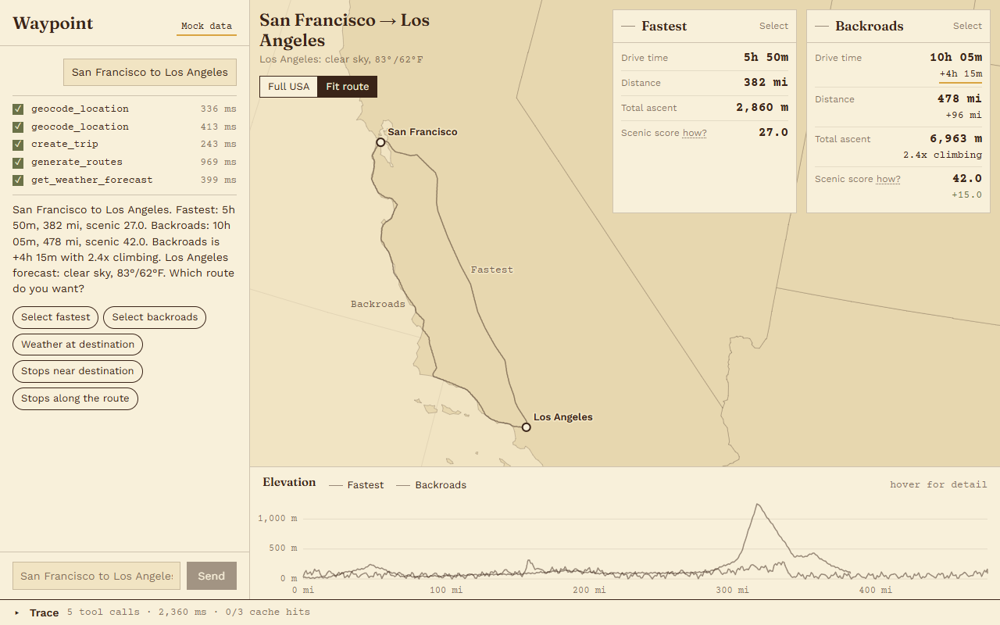
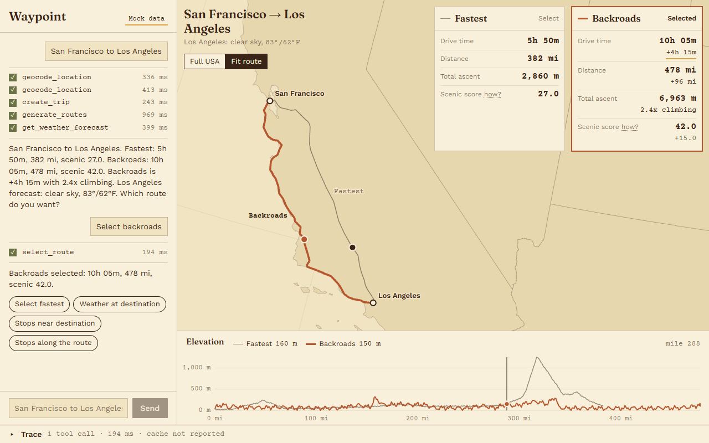
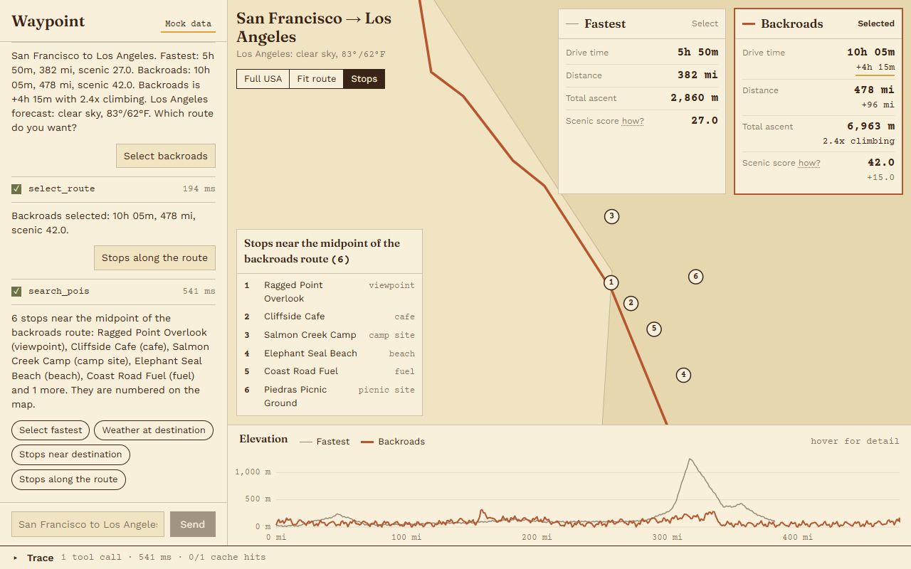
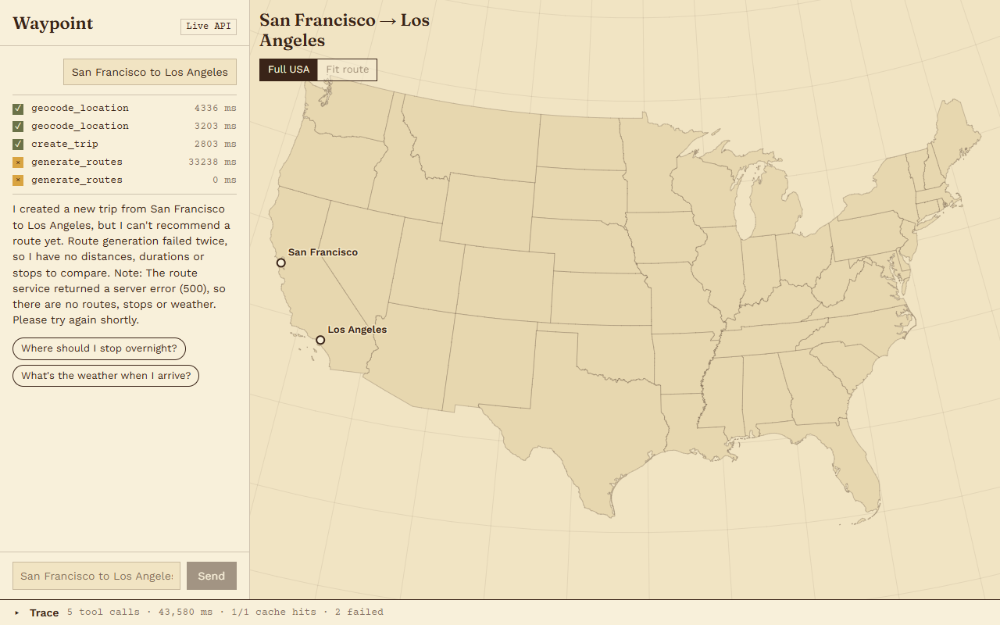
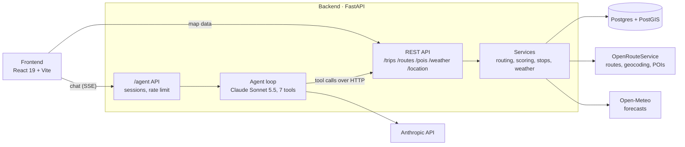

# Waypoint

AI road-trip planner: a Claude tool-calling agent plans routes, overnight stops and weather on a FastAPI + PostGIS backend. React frontend. Agent evals: 1/10 → 10/10 cases.

Ask for a drive ("San Francisco to Los Angeles, I'll take the backroads and leave tomorrow at 8am") and the agent geocodes both ends, generates a fastest and a backroads route, splits the drive into days, checks the weather at each stop **on the day you'll be there**, and finds places to stop. Every number it tells you comes from a tool result, and the app shows each tool call as it runs.



## Contents

- [Features](#features)
- [Screenshots](#screenshots)
- [How it works](#how-it-works)
- [Evals](#evals)
- [Tests and checks](#tests-and-checks)
- [Getting started](#getting-started)
- [API](#api)
- [Project structure](#project-structure)
- [Known limitations](#known-limitations)
- [Roadmap](#roadmap)
- [License](#license)

## Features

- **Two routes per trip.** A fastest route and a backroads route (avoiding highways), compared on drive time, distance, total climb and a terrain-based scenic score.
- **Overnight stops.** A deterministic planner splits long drives into days, honouring a daily driving limit and a departure time.
- **Weather on arrival dates.** Forecasts are fetched for each stop on the date you reach it, in that place's time zone.
- **Points of interest.** Food, fuel, lodging and sights near the destination or along the selected route.
- **Grounded answers.** The agent may only state numbers, dates and places that appear in its tool results, and it reports a failed tool rather than filling the gap.
- **Visible reasoning.** Each tool call streams to the chat as it runs (server-sent events), and a trace drawer shows latency, cache hits and errors per call.
- **Mock mode.** The frontend runs entirely from fixtures, with no backend or API keys, for demos and UI work.

## Screenshots

These were captured on 2026-10-18 from the current build in mock mode (fixture data; the agent's replies are scripted in mock mode), except the last one, which is the live agent.

**Routes compared.** Fastest vs backroads, with the deltas that matter: +4h 15m, 2.4x the climbing, scenic 27 vs 42.


**Backroads selected, elevation profile.** Hovering the profile moves a marker along the route on the map.


**Stops along the route.** Points of interest near the midpoint of the selected route, numbered on the map.


**Tool trace.** Every call the agent made for the last message, with status, latency and cache result.


**Live agent when a service fails.** On 2026-10-18 OpenRouteService was timing out. The agent, running for real, reported the failure and asked to retry instead of inventing a route. The map shows the two geocoded endpoints and nothing more.


## How it works



The agent's tools call the backend's own REST API over HTTP, so the agent and the frontend share one code path for trips, routes, POIs and weather.

### The agent

[`Backend/app/agent/orchestrator.py`](Backend/app/agent/orchestrator.py) runs a tool-use loop on the Anthropic Messages API:

- **Model is configuration.** `AGENT_MODEL` (default `claude-sonnet-5-5`) and `AGENT_EFFORT` come from settings; nothing is hardcoded.
- **Structured final answer.** The last response is JSON matching a schema: `summary`, `recommended_route_type`, `departure_window`, `stops` (ids from `plan_stops`) and `warnings`. The chat shows the summary, departure reason and warnings; the stop ids tie each recommendation to a planned stop, which the evals check.
- **Small context.** Route geometry and elevation samples are replaced by short summaries before the model sees them (the trace keeps the full result), and the system prompt and tool definitions are prompt-cached.
- **Per-turn cache.** An identical tool call in the same turn runs once.
- **Guard rails.** At most 20 model calls per turn; refusals and cut-off answers become a clean reply with a warning.

| Tool | What it does |
|---|---|
| `geocode_location` | Place name to coordinates and a canonical label |
| `create_trip` | Saves a trip; reuses one with the same endpoints from the last 24 hours |
| `generate_routes` | Fastest and backroads routes with distance, duration, climb and scenic score; reuses existing routes |
| `plan_stops` | Splits a route into driving days and returns overnight stops with arrival-date forecasts |
| `get_weather_forecast` | Forecast for a point on a target date |
| `search_pois` | Points of interest near a point |
| `select_route` | Locks in the route the user chose |

The system prompt is in [`Backend/app/agent/prompt.py`](Backend/app/agent/prompt.py). Its grounding rules: every number, date and place name must appear in a tool result (rounding, unit conversion, and differences or ratios of two tool numbers are allowed); coordinates passed to tools must come from other tool results; scores are never put on a scale ("/100", "out of 10").

### Scenic score

The scenic score measures terrain only: metres of climbing and descending per mile, mapped to 0-100.

```
density = (ascent_m + descent_m) / distance_miles
score   = 100 × density / (density + 40)
```

40 m/mi scores 50. Flat interstate lands around 20, SF to LA on I-5 around 38, the coastal backroads around 53, sustained mountain driving 70+. It is a relative value for comparing routes, not a rating. How much slower a route is gets reported separately as `duration_vs_fastest`. Details: [`scoring_service.py`](Backend/app/services/scoring_service.py).

### Overnight stops

[`stop_planning.py`](Backend/app/services/stop_planning.py) walks the route geometry by cumulative driving time and ends each day where the daily limit runs out. It calls no external service or model, so the same inputs always give the same stops. Each stop is reverse-geocoded for a name and gets the forecast for its arrival date.

## Evals

Ten scripted conversations run against the real agent and a live local backend, graded by seven checks: six deterministic, one with a Claude Haiku 5.5 judge. Full method, cases and blind spots: [`Backend/evals/README.md`](Backend/evals/README.md).

Results on 2026-10-16, agent on Claude Sonnet 5.5, before and after the grounding work:

| Check | Baseline | Final |
|---|---|---|
| a. Every number grounded in a tool result | 8/10 | 10/10 |
| b. No invented scale ("/100") | 10/10 | 10/10 |
| c. Stops are real places from tool results | 6/10 | 10/10 |
| d. Weather fetched for arrival dates | 6/10 | 10/10 |
| e. POI searches at grounded coordinates | 10/10 | 10/10 |
| f. No duplicate trips or repeated calls | 10/10 | 10/10 |
| g. Concise reply (under 150 words, no emoji or tables) | 1/10 | 10/10 |
| **Cases passing every check** | **1/10** | **10/10** |
| Estimated cost of the whole run | $1.12 | $0.27 |

What changed between the two: a terrain-only scenic score, the deterministic `plan_stops` tool, a grounding prompt with a structured final answer, a per-turn tool cache, and idempotent trip and route creation. Cost fell about 76% because route geometry is no longer re-sent to the model on every loop iteration and the stable prefix is cached.

Read these numbers with two caveats: the final run is a single sample, and most final cases reused trips created by earlier runs, so fresh route generation was barely exercised.

```
cd Backend
python -m uvicorn app.main:app --port 8001
python -m evals.run --api-base http://localhost:8001
```

A full run costs well under $1 at the time of writing and stops itself at `--max-cost` (default $7).

## Tests and checks

Results on 2026-10-18:

| Check | Command | Result |
|---|---|---|
| Backend unit and API tests | `pytest` | 94 passed in 8.5 s |
| Python lint | `ruff check .` | All checks passed |
| Frontend types | `npm run typecheck` | 0 errors |

The tests cover the agent HTTP API (sessions, rate limits, timeouts, streaming, error shapes) with the model stubbed out, every eval check on synthetic sessions, the scenic score, stop planning, trip matching and arrival-date weather across time zones. They make no network calls, but the app reads its settings at import time, so a `Backend/.env` must exist (copying `.env.example` is enough).

## Getting started

### Prerequisites

- Python 3.13
- Node.js 22
- PostgreSQL with the PostGIS extension
- An [OpenRouteService](https://openrouteservice.org/dev/#/signup) API key (free tier) and an [Anthropic](https://console.anthropic.com/) API key

The frontend's mock mode needs only Node.

### Backend

```bash
cd Backend
python -m venv .venv
source .venv/bin/activate          # Windows: .venv\Scripts\activate
pip install -r requirements.txt
cp .env.example .env               # then fill in the database and API keys
python -m alembic upgrade head     # creates the tables in your PostGIS database
python -m uvicorn app.main:app --port 8000
```

Every setting is listed with a comment in [`Backend/.env.example`](Backend/.env.example). Interactive API docs are at http://localhost:8000/docs.

### Frontend

```bash
cd Frontend
npm install
npm run dev                        # mock mode: fixtures, no backend needed
```

For the live agent, start the backend first, then:

```bash
VITE_USE_MOCK=false npm run dev                     # bash
$env:VITE_USE_MOCK = "false"; npm run dev           # PowerShell
```

Open http://localhost:5173. The backend allows CORS from that origin by default (`CORS_ORIGINS`). More detail: [`Frontend/README.md`](Frontend/README.md).

### Running the checks

```bash
cd Backend && pip install pytest ruff && pytest && ruff check .
cd Frontend && npm run typecheck
```

## API

| Method | Path | Purpose |
|---|---|---|
| POST | `/agent/sessions` | Start a conversation |
| POST | `/agent/message` | One agent turn, JSON response |
| POST | `/agent/message/stream` | The same turn as server-sent events: `tool_start`, `tool_end`, then `final` |
| GET | `/location/search` | Geocode a place name |
| POST | `/trips/` | Create a trip (`reuse_recent=true` returns a matching one from the last 24 h) |
| GET | `/trips/trips` | List trips |
| GET | `/trips/{trip_id}` | A trip with its routes |
| POST | `/trips/{trip_id}/plan` | Overnight stops for a route |
| POST | `/routes/generate/{trip_id}` | Fastest and backroads routes |
| POST | `/routes/select/{route_id}` | Select a route |
| GET | `/pois/`, `/pois/search` | Points of interest |
| GET | `/weather/current`, `/weather/forecast` | Current weather and forecasts |

Agent endpoints return errors as `{"error": {"code", "message"}}`.

## Project structure

```
Backend/
  app/
    agent/        orchestrator (tool loop), system prompt, sessions, the 7 tools
    api/v1/       FastAPI endpoints and serializers
    core/         settings and database engine
    models/       SQLAlchemy + GeoAlchemy models: trip, route, POI
    schemas/      Pydantic request and response models
    services/     routing, geocoding, POIs, weather, scoring, stop planning
  alembic/        database migrations (4)
  evals/          eval cases, checks, runner and the baseline/final reports
  tests/          pytest suite
Frontend/
  src/
    components/   map, route comparison, elevation profile, chat, trace drawer
    state/        trip state and the chat/agent flow
    fixtures/     mock trip and POIs
docs/screenshots/ the images in this README
```

## Known limitations

- **OpenRouteService timeouts.** Route requests time out after 30 s, and a timeout surfaces as an HTTP 500. The fastest and backroads requests run one after the other. On a slow ORS day (2026-10-18: 76 s and 109 s) route generation fails; the agent reports it rather than guessing.
- **Sessions are in memory.** They are lost on restart, and with several worker processes each worker has its own. Run one worker for now.
- **No database in docker-compose.** `Backend/docker-compose.yml` starts only Redis; Postgres/PostGIS must be installed separately.
- **Stop planning assumes a uniform pace** along the route and uses the origin's time zone for the whole trip.
- **The evals are one sample** and have documented blind spots (place names are found by heuristic; any tool number can ground an equal number in the reply).
- **US only.** The map and prompt target US road trips.

## Roadmap

Planned work, roughly in order:

- [ ] Handle ORS timeouts as a clear 502/504 with a retry, and request both routes in parallel
- [ ] Postgres/PostGIS in `docker-compose.yml` so the whole stack starts with one command
- [ ] Redis-backed agent sessions behind the existing `SessionStore` interface, for multiple workers
- [ ] CI on every push: `pytest`, `ruff` and `npm run typecheck`
- [ ] Repeat eval runs, including against an empty database, to exercise fresh route generation and measure variance
- [ ] Live-mode screenshots in this README once ORS is responsive
- [ ] Stop planning with real per-segment pace and time-zone changes along the route
- [ ] Deployment: a hosted backend and frontend

## License

[MIT](LICENSE)
